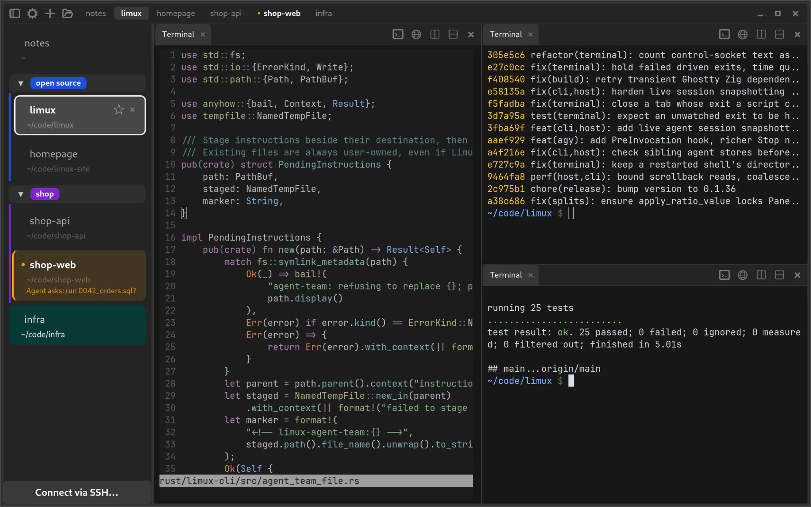

<p align="center">
  
</p>

<h1 align="center">Limux</h1>

<p align="center">
  <b>Know which terminal needs you.</b><br>
  A native terminal workspace manager for Linux, rendered on the GPU by Ghostty.
</p>

<p align="center">
  <a href="https://github.com/am-will/limux/releases/latest"></a>
  <a href="https://github.com/am-will/limux/actions/workflows/rust-quality.yml"></a>
  <a href="LICENSE"></a>
</p>

<p align="center">
  <a href="#install">Install</a> ·
  <a href="#your-first-five-minutes">First five minutes</a> ·
  <a href="#coding-agents">Coding agents</a> ·
  <a href="#keyboard-shortcuts">Shortcuts</a> ·
  <a href="#documentation">Docs</a>
</p>



Limux keeps every project in its own workspace, with its own folder, splits, tabs, and browser. When a build fails or an agent asks a question in a terminal you are not looking at, that terminal lights up. One shortcut takes you to it.

[Watch the demo video](https://github.com/user-attachments/assets/6f3047c2-e2b6-49f2-b536-570a1570d0f8) (85 seconds).

On a Mac? Use [cmux](https://github.com/manaflow-ai/cmux), the app that inspired Limux.

## What you get

| Feature | What it does |
|---|---|
| **Attention that finds you** | Unread marks on the tab, the workspace, and the top bar. `Ctrl+Alt+U` jumps to the next unread terminal. A process that ends out of sight keeps its output and offers **Restart**. |
| **Workspaces** | One per project, with favorites, colors, groups, and drag-and-drop. Everything comes back after a restart. |
| **Splits, tabs, and zoom** | Native panes with keyboard navigation. Drag tabs between panes and workspaces. |
| **Ghostty terminals** | OpenGL rendering through embedded Ghostty. Limux reads your existing Ghostty configuration. |
| **A browser next to your code** | WebKitGTK in a tab or a split, sandboxed by default, with the Web Inspector. |
| **A command line for everything** | Open panes, type into them, and read their screens from any script with the `limux` command. |
| **Coding agent support** | Hooks for Codex, Claude Code, Gemini CLI, Antigravity (`agy`), and OpenCode: notifications, and sessions that resume after a restart. |
| **SSH workspaces** | Optional tmux-backed tabs that reconnect after a dropped link, with image paste to the remote host. |

## Install

Release packages need glibc 2.39 or newer: Ubuntu 24.04, Debian 13, Fedora 40, Arch Linux, or anything more recent. Get the files from the [latest release](https://github.com/am-will/limux/releases/latest).

| Distribution | Commands |
|---|---|
| **Debian, Ubuntu** | `sudo apt install ./limux_*_amd64.deb` |
| **Fedora** | `sudo dnf install ./limux-*.x86_64.rpm` |
| **Arch Linux** | `yay -S limux-bin` |
| **AppImage** | `chmod +x Limux-*.AppImage`, then `./Limux-*-x86_64.AppImage` |
| **Tarball, no root** | `./install.sh --prefix="$HOME/.local"` |
| **Source** | See [Build from source](#build-from-source) |

Start it from your application menu, or run `limux`.

[docs/install.md](docs/install.md) covers ARM64 files, runtime dependencies, the browser sandbox, AppImage details, and how to uninstall. Ubuntu 22.04 is not supported ([#10](https://github.com/am-will/limux/issues/10)).

## Your first five minutes

1. **Open a project.** Select the folder icon in the top bar and choose a folder. The workspace takes its name.
2. **Split it.** Press `Ctrl+Alt+D` to split right and `Ctrl+Alt+Shift+D` to split down. Move between panes with `Ctrl+Alt+Arrow`.
3. **Zoom.** Press `Ctrl+Shift+Z` to fill the window with one pane. Press it again to go back.
4. **Make something ask for you.** Run this command, then switch to another workspace before it finishes:
   ```bash
   sleep 5; limux notify "Look at me"
   ```
5. **Answer it.** Press `Ctrl+Alt+U`. You are in the terminal that called you.
6. **Make it yours.** Right-click a workspace to rename, color, or group it. Settings has fonts, color schemes, and key bindings.

## Coding agents

Install the hooks once:

```bash
limux hooks setup
```

Your agents now notify you when they finish or need input. Their sessions resume when Limux restarts.

Agents can also use the window themselves. Limux tells every terminal its own workspace, pane, and surface, so these commands need no IDs:

```bash
# Open a helper next to the current pane
limux new-pane --direction right --command claude

# Start one pane per agent and write an AGENTS.md that explains how they talk
limux agent-team --agents codex,claude --cwd "$PWD"

# Ask the human
limux notify --subtitle "needs review" --body "blocked on auth choice" "Input needed"

# Save running agent sessions before an upgrade
limux hooks snapshot --save-session
```

[docs/agents.md](docs/agents.md) has the full guide. `limux --help` lists every command.

## Keyboard shortcuts

Most defaults use `Ctrl+Alt`, so plain `Ctrl` editing keys still reach the program in the terminal.

| Shortcut | Action |
|---|---|
| `Ctrl+Alt+U` | Next unread terminal |
| `Ctrl+Alt+O` | Most recent workspace |
| `Ctrl+Alt+1-9` | Workspace by number |
| `Ctrl+Alt+Shift+N` | New workspace |
| `Ctrl+Alt+D` / `Ctrl+Alt+Shift+D` | Split right / split down |
| `Ctrl+Alt+Arrow` | Focus pane in direction |
| `Ctrl+Shift+Z` | Zoom the focused pane |
| `Ctrl+Alt+T` | New terminal tab |
| `Ctrl+Shift+W` / `Ctrl+Alt+W` | Close tab / close pane |
| `Ctrl+Alt+F` | Find in the terminal or browser |
| `Ctrl+Shift+C` / `Ctrl+Shift+V` | Copy / paste |
| `Ctrl+Alt+M` | Toggle the sidebar |

See [all shortcuts](docs/keyboard-shortcuts.md). Change them in **Settings > Keybindings**.

## Configuration

| File | What it holds |
|---|---|
| `~/.config/ghostty/config` | Your Ghostty settings. Limux reads them. |
| `~/.config/limux/settings.json` | Limux settings. Use the Settings window to change them. |
| `~/.config/limux/shortcuts.json` | Custom key bindings ([format](docs/shortcut-remap-testing.md)). |
| `~/.local/share/limux/session.json` | Saved workspaces and layouts. |

Limux has no telemetry and no account. Its control API is a Unix socket on your machine.

## Documentation

| Guide | Contents |
|---|---|
| [Install](docs/install.md) | Packages, dependencies, browser sandbox, uninstall |
| [Using Limux](docs/usage.md) | Workspaces, autostart, notifications, exited terminals, image paste, window activation |
| [Coding agents](docs/agents.md) | Hooks, notifications, agent teams, scripting panes |
| [Keyboard shortcuts](docs/keyboard-shortcuts.md) | Every default binding |
| [SSH workspaces](docs/ssh.md) | Persistent sessions, reconnect, remote notifications |
| [Flatpak](flatpak/README.md) | Local Flatpak build |
| [Roadmap](docs/cmux-parity-plan.md) | What is done and what is next |

## Build from source

You need stable Rust, Zig 0.16.0, and the development packages for GTK4, libadwaita, and WebKitGTK 6.0.

```bash
# Ubuntu or Debian
sudo apt install libgtk-4-dev libadwaita-1-dev libwebkitgtk-6.0-dev pkg-config build-essential

git clone --recurse-submodules https://github.com/am-will/limux
cd limux
./scripts/build-ghostty.sh
cargo build --release

LD_LIBRARY_PATH=ghostty/zig-out/lib:$LD_LIBRARY_PATH ./target/release/limux
```

`./scripts/package.sh` builds the binary, bundles `libghostty-internal.so`, icons, and an install script into a tarball. It rebuilds the library with `ReleaseFast` and `-Dcpu=baseline`, so it also needs Zig 0.16.0 and an initialized Ghostty submodule.

## Contributing

Run the quality gate before you commit:

```bash
./scripts/check.sh
```

Start with [CONTRIBUTING.md](CONTRIBUTING.md). Coding agents that work on Limux itself should read [AGENTS.md](AGENTS.md) and [CLAUDE.md](CLAUDE.md).

| Crate | Role |
|---|---|
| `rust/limux-host-linux` | GTK4 and libadwaita app: window, sidebar, panes, tabs |
| `rust/limux-cli` | The `limux` command |
| `rust/limux-control` | Unix socket path, authentication, and server |
| `rust/limux-core` | Command dispatcher and state engine |
| `rust/limux-protocol` | Socket message types and the method registry |
| `rust/limux-ghostty-sys` | FFI bindings to libghostty |

## Thanks

Limux exists because of [Ghostty](https://ghostty.org) and [cmux](https://github.com/manaflow-ai/cmux). [Anton Barchukov](https://github.com/antonbarchukov) created the original Arch packaging in [#50](https://github.com/am-will/limux/pull/50).

## License

[MIT](LICENSE)
